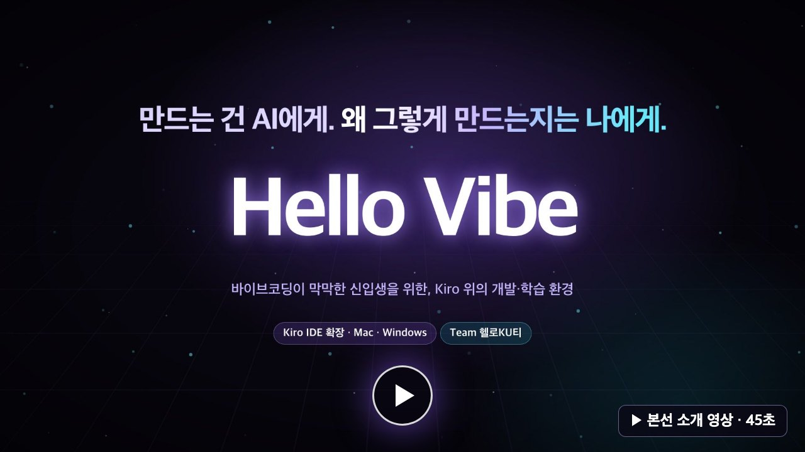

# Hello Vibe

**만들면서, 이해의 근거를 남기는 Kiro 기반 바이브코딩 개발 환경**

고려대학교 × AWS AI Innovators Challenge 본선 · 팀 Hello-KU-tty

Hello Vibe는 코딩 초보자가 배우고 싶은 기술 하나로 시작해 자기에게 필요한 TypeScript 서비스를 실제로 완성하도록 돕는 Kiro IDE 확장이다. 학습자는 평소처럼 Kiro 채팅으로 바이브코딩하고, Hello Vibe는 Kiro의 Steering·MCP·Hook과 확장 패널로 그 흐름에 개입한다. 만드는 중 실제로 정해야 할 것은 학습자에게 묻고, 학습자가 직접 쓴 말만 이해의 근거로 쌓아 다음 설명과 프로젝트 추천까지 개인화한다.

| 저장소 | 역할 |
| --- | --- |
| [Hello-KU-tty/core](https://github.com/Hello-KU-tty/core) (이 저장소) | TypeScript Core, SQLite 저장소, Kiro 연결(Steering·MCP·Hook), Agent prompt, 설치물 포장, 평가·테스트 |
| [Hello-KU-tty/program](https://github.com/Hello-KU-tty/program) | Kiro 확장 frontend: Vibe Helper 패널(프로젝트 찾기 · Learning Spec · 진행 · 학습 기록) |

## 소개 영상

[](docs/assets/hello-vibe-finals-45s.mp4)

본선 설치물로 실제 Kiro IDE에서 새 프로젝트 하나를 처음부터 진행한 흐름이다(45초, [영상 파일](docs/assets/hello-vibe-finals-45s.mp4)). 배우고 싶은 것과 개인 사정 입력 → 그 기술이 꼭 필요한 프로젝트 후보 10개 → 대화로 두 후보를 합쳐 하나로 좁힘 → Learning Spec(내가 배울 것 · Agent가 맡을 것 · 이번엔 뺄 것) → 학습자의 Kiro 채팅 Agent가 만들다가 실제 갈림길에서 멈추고 질문 → `/vibe-helper`에 자기 상황을 붙여 질문(Helper는 읽기 전용) → 번호와 이유를 자기 말로 답함 → 학습 기록은 학습자가 쓴 이유만 이해 근거로 인정하고, Helper에게 질문만 한 것과 AI가 작성한 코드의 개념은 근거로 세지 않음 → 고른 기준대로 완성된 선착순 신청 앱(같은 학번 중복 신청 거절, 10명이 동시에 신청해도 정원 5명만 접수) → 다음 프로젝트 추천 3개.

[예선 제출 때 영상](https://github.com/user-attachments/assets/aacdf659-c0f1-465a-b23b-72a0256fe466)은 Builder와 Helper가 패널 안에서 돌던 예선 설치물의 흐름이다.

## 해결하려는 문제

- AI가 동작하는 코드를 만들어도, 사용자는 중요한 제품·기술 판단의 의미를 모를 수 있다.
- 설명·퀴즈·진도 중심의 교육 도구는 실제 개발 흐름을 끊는다.
- 배우고 싶은 기술이 있어도 그 기술이 정말 필요한 프로젝트를 찾기 어렵다.
- "Agent가 코드를 썼다"와 "사용자가 이해했다"가 쉽게 혼동된다.

## 핵심 원칙

- **Build-first:** 교육 때문에 개발을 멈추지 않는다. 학습자의 Kiro 채팅이 실제 서비스를 앞으로 민다.
- **실제 판단만 요청:** 교육용 가짜 선택지 대신 개발 중 실제로 생긴 Decision만 사용자에게 남긴다.
- **보수적 Evidence:** 확인 응답, 카드 클릭, Agent 답 반복, Agent가 작성한 코드는 이해의 근거가 아니다. 사용자 본인의 설명·예측·판단·적용만 기록한다.
- **Local-first:** 상태는 사용자 컴퓨터의 SQLite에 저장한다. cloud sync는 없다.

## 사용자 흐름

```text
Vibe Helper 패널
  배우고 싶은 기술 입력 (+ 선택적인 개인 필요)
  → Discovery: 프로젝트 후보, 대화로 좁히기
  → Learning Spec: 내가 이해할 것 / Agent가 맡을 것 / 제외할 것 → "이걸로 시작"
Kiro 채팅 (새 세션)
  → Builder: 실제 코드·테스트·실행, 실제 선택이 생기면 번호 선택지로 묻고 기다림
  → 고르기 전 "/vibe-helper 질문"으로 Helper에게 묻기 (읽기 전용, 선택으로 기록하지 않음)
  → 번호와 이유 한 문장으로 답하기 → 그 이유가 Evidence 후보
Core (뒤에서)
  → Task 완료 → Episode 단위 Evidence 분석 → Concept State 갱신 또는 보류
  → 다음 작업후보 3개 생성
Vibe Helper 패널
  → 진행 탭: 지금 할 일, 고른 것, 다음 작업후보("다음 작업후보 N번 진행해"를 복사해 채팅으로)
  → 학습 기록 탭: 내 이유와 Evidence, 다음 설명·추천 개인화
```

Concept State는 `OBSERVED → EXPLAINED → DEMONSTRATED → TRANSFERRED` 순서로만 올라가며, 오해는 상태 강등이 아니라 해결 가능한 open issue로 남는다.

## Agent와 Core

| 구성 | 실행 위치 | 하는 일 | 권한 |
| --- | --- | --- | --- |
| Builder | 학습자의 Kiro 채팅(Kiro Agent) | 실제 코드·테스트·실행, 실제 선택을 번호 선택지로 묻기 | Kiro의 파일·명령 도구. Hello Vibe는 Steering으로 행동을 조정하고, Builder MCP 도구(`check_progress`, `start_task`, `ask_choice`, `save_choice`, `save_progress`, `finish_task`)로 진행만 기록하게 한다 |
| Helper | 같은 Kiro 채팅의 `/vibe-helper 질문`(manual Steering) | 현재 코드·선택 맥락으로 설명, 선택지 비교 | 읽기 전용: 코드 수정·명령 실행을 하지 않고 선택으로 기록하지 않는다 |
| Discovery | Core가 kiro-cli로 실행 | 후보 생성·좁히기, Learning Spec 초안, Task 완료 뒤 다음 작업후보 | 코드·shell 없음 |
| Evidence Analyst | Core가 kiro-cli로 실행 | 끝난 Episode에서 Evidence 제안 | 도구 없음, 제안만 |
| TypeScript Core | 사용자 컴퓨터의 local process | validation, 권한 경계, deterministic 상태 계산, SQLite 저장 | 유일한 상태 변경 주체 |

모든 Agent는 학습자 본인의 Kiro 계정과 모델로 동작한다. Agent는 제안만 하고, 이해 상태의 판정은 Core의 deterministic reducer가 한다. Builder와 Helper에는 Evidence·Concept State를 바꾸는 도구가 없다.

## 시스템 구조

```text
Kiro IDE
 ├─ Kiro 채팅: 학습자의 Kiro Agent(Builder), "/vibe-helper" 질문(Helper)
 │   ├─ Steering  .kiro/steering/vibe-helper*.md   선택을 묻는 규칙, 학습자 요약
 │   ├─ MCP       vibe-helper (bridge → Core)       진행·선택·완료 기록, Helper 맥락 조회
 │   └─ Hook      UserPromptSubmit · Stop           학습자 발언과 턴 끝을 Core에 기록
 └─ Hello Vibe 확장 (Hello-KU-tty/program + Core host)
     ├─ Vibe Helper 패널: 프로젝트 찾기 · Learning Spec · 진행 · 학습 기록
     ├─ Project 폴더 연결: .kiro/specs, Steering, MCP, Hook, 안전한 명령 미리 승인(선택)
     └─ local Core 자동 기동·연결·복구
          ├─ 인증된 loopback HTTP/SSE(패널)와 MCP bridge(Kiro 채팅)
          ├─ kiro-cli 실행기: Discovery · 다음 작업후보 · Evidence Analyst
          ├─ SQLite: Project · Task · Decision · Event/Episode · Evidence
          └─ 저장 전 secret·민감 경로 redaction
```

Project 폴더는 학습자가 Kiro에서 연 빈 폴더이거나, 파일이 있으면 Core가 만든 새 폴더(새 창)다. Core는 등록된 폴더 밖의 경로를 받지 않는다. 기술 세부는 [ARCHITECTURE §3.5](docs/ARCHITECTURE.md#35-본선-kiro-native-adapter-구조), 본선 방향은 [PROJECT_BRIEF §0](PROJECT_BRIEF.md#0-본선-방향-kiro-native-개입)에 있다.

## 다운로드·설치

본선 설치물은 Kiro-native **0.2.14**(Apple Silicon Mac, Windows x64)이다. 준비물, 내려받기, 첫 프로젝트, 업데이트와 문제 해결은 [**설치 가이드**](docs/DOWNLOAD_GUIDE.md)에 있다.

**[Mac용 0.2.14 내려받기](https://github.com/Hello-KU-tty/core/raw/refs/heads/main/releases/macos/kiro-native/builder-helper-agent-panel-0.2.14-darwin-arm64.vsix)** · **[Windows용 0.2.14 내려받기](https://github.com/Hello-KU-tty/core/raw/refs/heads/main/releases/windows/kiro-native/builder-helper-agent-panel-0.2.14-win32-x64.vsix)**

1. [Kiro IDE](https://kiro.dev/downloads/) 최신판과 Kiro CLI(2.21.1 이상)를 설치하고 둘 다 로그인한다.
2. Kiro Extensions → `…` → `Install from VSIX…`로 설치한 뒤 다시 로드한다.
3. Vibe Helper 패널에서 배우고 싶은 것을 입력해 프로젝트를 고르고, **이걸로 시작** 뒤 Kiro 채팅의 새 세션에서 만든다.

별도 서비스 계정이나 API Key는 없고, 모델 사용량은 본인 Kiro 계정에서 차감된다. Node·pnpm 수동 설치도 필요 없다. 예선 설치물(Mac 0.1.4, Windows 0.0.18, Kiro 1.1.70 전용)과 개발자 ZIP은 [예선 다운로드 가이드](docs/archive/preliminary/DOWNLOAD_GUIDE_PRELIMINARY.md)에 남아 있다. 본선 0.2.14의 검증은 아래 "본선 0.2.14 검증"과 [본선 인계 문서](docs/FRONTEND_KIRO_NATIVE_HANDOFF.md)에 있고, 그 아래 표는 예선 설치물 기준이다.

## 개발 환경과 검증

필수 도구는 Node.js 24.x(권장 24.19.0)와 pnpm 11.13.1 이상 11.x(권장 11.13.1)다. Node 메이저는 포장 SQLite 네이티브 모듈 때문에, pnpm은 lockfile 때문에 맞춘다. `engines`와 preflight가 범위 밖 runtime을 거절한다.

```bash
pnpm install --frozen-lockfile
pnpm exec playwright install chromium
pnpm check
```

`pnpm check`는 format, lint, typecheck, DB schema, unit, SQLite integration, 평가 calibration, Campus Drop fixture, build, smoke와 Chromium E2E를 실행한다. 모든 자동 검사는 실제 모델을 호출하지 않는다. 기본 E2E 포트가 사용 중이면 `VIBE_E2E_FRONTEND_PORT`로 빈 포트를 지정한다.

Kiro native 연동과 확장 패널 검사:

```bash
pnpm panel:build
node --test examples/kiro-panel/test/*.test.cjs
node --test examples/program-macos-dev/test/*.test.cjs
node scripts/test-program-consumer.mjs <program checkout 경로>
```

실제 모델을 쓰는 live probe(`pnpm test:eval:live-*`)는 Kiro 로그인 환경에서 본인 계정 사용량을 소비한다. 평가 실행법은 [tests/eval/README.md](tests/eval/README.md)에 있다.

### 본선 0.2.14 검증

| 검사 | 결과 |
| --- | --- |
| Mac 자동 검사 (Node 24.19.0) | backend typecheck, unit 177, integration 566, 패널 196 PASS; program typecheck, 875 tests PASS; Mac 포장 검사 9개 PASS |
| Windows 자동 검사 (Windows 11 x64) | backend unit 179, integration 562, 패널 197 PASS; program 875 tests PASS |
| Mac 실제 Kiro (1.2.56, 0.2.13에서 업그레이드) | Steering 0.9.7 적용, 새 채팅 세션의 Vibe Helper 도구 호출, 창을 다시 로드한 뒤 거절된 호출을 되풀이하지 않음, Project 터미널 준비가 실패해도 패널과 다음 작업후보 유지 |
| Windows 실제 Kiro (1.2.56, 0.2.13에서 업그레이드) | 상속 권한 폴더를 시작 때 바로잡고 진행 탭 정상, 새 채팅 세션에서 Task 완료 → 다음 작업후보 → 다음 Task 시작, 승인 창 없음 |

### 예선 설치물 검증 결과 (macOS arm64, Node 24.19.0)

| 검사 | 결과 |
| --- | --- |
| ZIP 압축 해제본 backend `pnpm check` | unit 177, integration 418, eval 43, Campus Drop 3, smoke 6, E2E 12 PASS (Windows 전용 등 11 SKIP) |
| 패널·개발 host·source 회귀 | 219 PASS, 2 SKIP |
| frontend 0.0.18 (`program`) | typecheck, 807 tests, build PASS |
| 실제 frontend → HTTP/SSE → SQLite consumer | PASS (모델 경계는 deterministic fixture) |
| 완료 뒤 후속 Builder·Helper | 각 3회, 중복 방지·재접속·기존 완료 보고/파일 보존 PASS (합성 Agent) |
| Mac 0.1.4 설치·Core·도구 | 격리 Kiro 설치, 실제 패키지 검사9개 PASS, 설치 자산69개·재빌드72항목 hash 일치; [재현·항목별 hash](docs/MAC_VSIX.md) |
| Mac 0.1.4 권한 거부 | 거부 3회 뒤에도 Builder 턴 정상 종료(같은 수정 번들의 개발 로드). [수정 기록](docs/archive/preliminary/PERMISSION_DENIAL_FIX_20260930.md) |
| Mac 0.1.3 실제 모델 | 앱 생성·실행, Decision 선택·반영·Helper2회·재시작 복원·실제 취소 후 재개 확인. [범위와 실패 기록](docs/archive/preliminary/MAC_NATIVE_VERIFICATION_20260930.md); MVP 전체·다음 개인화 완료를 뜻하지 않음 |
| 의존성 감사 | backend pnpm audit, frontend npm audit 모두 0건 |
| 이전 9/28 개발 환경 실제 모델 수직 흐름 | 학습 목표 입력 → 후보 10개 → Spec 확정 → Builder Decision → Task 완료 → Helper → 후속 Task로 결과 수정 → 재시작 후 복원 (새 설치물의 모델 완주 검증은 아님) |

실제 흐름 기록은 [docs/FRONTEND_MAC_PROGRESS_20260928.md](docs/archive/preliminary/FRONTEND_MAC_PROGRESS_20260928.md), 보안·접근성 감사는 [docs/T20_AUDIT_20260928.md](docs/archive/preliminary/T20_AUDIT_20260928.md), 독립 소스 재현은 [docs/SOURCE_REPRODUCIBILITY_20260928.md](docs/archive/preliminary/SOURCE_REPRODUCIBILITY_20260928.md)에 있다.

## 사용자 검증

실제 초보 사용자 사용과 후속 인터뷰를 진행했다. 제출한 서비스 소개서에는 프로젝트를 고르는 데 도움을 받았고, 개발 중 필요한 개념 설명과 이후 회상에 도움이 됐다는 정성 피드백을 담았다. 이는 사용자 확인과 인터뷰에 근거한 관찰이며, 아래 자동 테스트나 합성 입력 검증과는 별개다.

일반 Kiro 대비 통제된 비교·정량 학습 효과 검증은 아직 수행하지 않았다. 인터뷰의 긍정적 반응을 인과적인 학습 효과나 모든 사용자의 결과로 확대하지 않는다.

## 알려진 한계

- 실제 사용 인터뷰는 정성 검증이며 일반 Kiro 대비 비교·정량 효과는 미검증이다. Mac 설치본의 합성 입력 기반 기술 검증과도 구분한다.
- Kiro 채팅의 Builder는 Steering으로 안내받을 뿐 강제되지 않는다. 선택을 묻지 않고 진행할 수 있으며, Core는 기록된 선택의 출처와 학습자 원문만 검증한다. `/vibe-helper` 턴의 읽기 전용도 프롬프트로 지킨다.
- Steering은 채팅 세션을 열 때 고정되므로, 업데이트 뒤에는 Kiro 채팅의 새 세션에서 이어 가야 새 안내가 적용된다.
- 지원 환경은 Apple Silicon Mac과 Windows x64의 Kiro IDE·Kiro CLI다. Intel Mac, Windows ARM, Linux는 지원하지 않는다.
- Evidence Analyst가 미래 계획을 실제 수행으로 잘못 분류할 수 있다. Core는 구조·출처·권한을 검증하지만 자연어 의미의 정확성까지 보장하지 않는다.
- 생성 프로젝트는 새 TypeScript 프로젝트로 한정한다. 기존 프로젝트 import, 다른 coding agent, cloud sync는 범위 밖이다.
- redaction은 알려진 형태 중심이며 모든 개인정보를 탐지하지 않는다. 생성 코드 실행은 OS 수준 sandbox가 아니다.

## 저장소 구조

```text
apps/local-backend        local Core 실행, kiro-cli Agent 실행기
apps/mcp-server           MCP process composition root
apps/crew-app, crew-backend  초기 Crew App 경로 (회귀 근거로 보존)
packages/contracts        runtime schema와 shared DTO
packages/domain           deterministic entity·policy·reducer
packages/application      use case, transaction, redaction 경계
packages/runtime          workflow·결과 앱 runtime
packages/storage-sqlite   SQLite repository와 migration
packages/frontend-client  확장 frontend가 소비하는 SDK
packages/kiro-adapter     Kiro Steering·MCP·Hook·Spec 파일과 명령 승인 규칙
agents/, docs/agent-prompts/  Discovery·Builder·Helper·Analyst prompt와 Kiro Steering 원문
examples/kiro-panel       Kiro 확장 host(Core 기동·연결, Project 폴더 연결)
releases/                 Mac·Windows 설치물과 receipt
tests/                    unit, integration, eval, smoke, E2E, Campus Drop fixture
```

## 설계 문서

1. [PROJECT_BRIEF.md](PROJECT_BRIEF.md): 승인된 목표, 범위와 제약
2. [docs/SPEC.md](docs/SPEC.md): 검증 가능한 제품 요구와 완료 조건
3. [docs/ARCHITECTURE.md](docs/ARCHITECTURE.md): system boundary, data flow, test 전략
4. [docs/DECISIONS.md](docs/DECISIONS.md): 승인된 판단과 spike 결과
5. [docs/TASKS.md](docs/TASKS.md): 작업 순서와 진행 상태
6. [docs/agent-prompts/](docs/agent-prompts/): 네 Agent의 prompt와 Kiro Steering 원문

본선 확장 host와 Windows 빌드·확인은 [docs/FRONTEND_KIRO_NATIVE_HANDOFF.md](docs/FRONTEND_KIRO_NATIVE_HANDOFF.md)에 있다. 예선 frontend 연동 안내는 [docs/FRONTEND_IDE_IMPLEMENTATION_GUIDE.md](docs/FRONTEND_IDE_IMPLEMENTATION_GUIDE.md), 예선 Windows 확장 runtime 기록은 [docs/WINDOWS_EXTENSION_HANDOFF_20260923.md](docs/archive/preliminary/WINDOWS_EXTENSION_HANDOFF_20260923.md)에서 시작한다. `spikes/`는 외부 기능 경계를 확인한 폐기 가능한 실험물이다.
